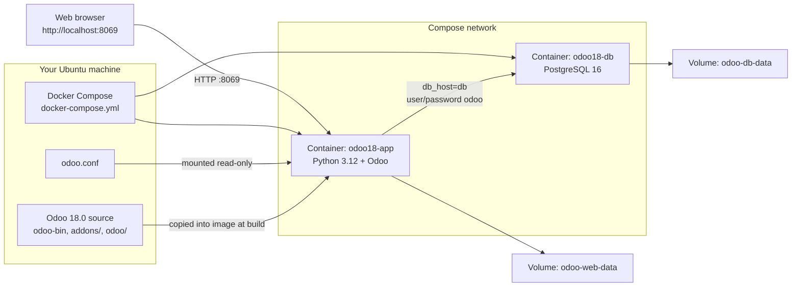

# Odoo 18.0 Docker Guide

This guide explains how this project's Docker setup works.
It is written for the files in this repository (`Dockerfile`, `docker-compose.yml`, `odoo.conf`, `.dockerignore`, `.env.example`).

---

## 1. What Docker is and why we use it for Odoo

**Docker** packages an application and everything it needs (Python, system libraries, configuration) into a **container**.

Why this helps for Odoo on Ubuntu 26.04:

- Your host has **Python 3.14**, but Odoo 18.0 is built and tested for **Python 3.10+**, with dependency pins aimed at **Ubuntu 24.04 / Python 3.12**.
- Docker runs Odoo with **Python 3.12 inside the container**, so you do **not** need to install Odoo’s Python packages on the host.
- PostgreSQL also runs in its own container, so you do not need a host PostgreSQL install.
- The same setup is easy to start, stop, and reset.

Think of Docker Compose as a small orchestra conductor: it starts Odoo and PostgreSQL together and connects them on a private network.

---

## 2. Overview of the Docker architecture

This project uses **two containers** managed by **one Compose file**:

| Piece | Role |
| --- | --- |
| `odoo` service | Builds from the local `Dockerfile`, runs this Odoo 18.0 source tree |
| `db` service | Official `postgres:16` image, stores Odoo databases |
| Named volumes | Keep PostgreSQL data and Odoo filestore when containers are recreated |
| `odoo.conf` | Tells Odoo how to reach PostgreSQL and where addons live |

### Mermaid diagram



---

## 3. The Odoo and PostgreSQL containers

### PostgreSQL (`db` / `odoo18-db`)

- Image: `postgres:16`
- Creates a database user from environment variables (`POSTGRES_USER`, `POSTGRES_PASSWORD`).
- `POSTGRES_DB=postgres` keeps PostgreSQL’s default maintenance database.
  Odoo creates its **own** databases later (for example `odoo` or a name you choose in the web UI).
- A **healthcheck** runs `pg_isready` so Compose knows when the database accepts connections.
- Data is stored in the named volume `odoo-db-data`.

### Odoo (`odoo` / `odoo18-app`)

- Built from the local source using `Dockerfile`.
- Waits until PostgreSQL is healthy (`depends_on` + `condition: service_healthy`).
- Starts with:

  `python3 odoo-bin -c /etc/odoo/odoo.conf`

- Exposes port **8069** (Odoo’s web interface).
- Stores attachments/filestore in named volume `odoo-web-data` at `/var/lib/odoo`.

---

## 4. Explanation of every instruction in the Dockerfile

File: `Dockerfile`

1. **`FROM python:3.12-slim-bookworm`**
   - Starts from a slim Debian Bookworm image with Python 3.12.
   - Chosen because Odoo 18’s `requirements.txt` is aligned with Ubuntu 24.04 / Python 3.12 packages.
   - Host Python 3.14 is **not** used.

2. **`ENV PYTHONDONTWRITEBYTECODE=1 PYTHONUNBUFFERED=1 LANG=C.UTF-8 ...`**
   - Avoids `.pyc` clutter, shows logs immediately, and uses a UTF-8 locale (important for PostgreSQL/client tools).

3. **`RUN apt-get update && apt-get install ...`**
   - Installs compilers and libraries needed to build Python packages such as:
     - `psycopg2` → `libpq-dev`, `postgresql-client`
     - `lxml` → `libxml2-dev`, `libxslt1-dev`
     - `Pillow` → JPEG/TIFF/WebP/zlib headers
     - `python-ldap` → `libldap2-dev`, `libsasl2-dev`
     - fonts / MIME info for reports and file type detection
   - `rm -rf /var/lib/apt/lists/*` keeps the image smaller.

4. **`WORKDIR /opt/odoo`**
   - Sets the working directory where the source tree lives and where `odoo-bin` is run.

5. **`COPY requirements.txt` then `pip install -r requirements.txt`**
   - Installs the exact Python dependencies from this repository.
   - Copied before the full source so Docker can **cache** this layer when only application code changes.

6. **`useradd ...`, `/var/lib/odoo`, and `chown odoo:odoo`**

   Relevant Dockerfile lines:

   ```dockerfile
   RUN useradd --system --create-home --home-dir /var/lib/odoo --shell /bin/bash odoo \
       && mkdir -p /var/lib/odoo \
       && chown -R odoo:odoo /var/lib/odoo
   ```

   Later:

   ```dockerfile
   COPY --chown=odoo:odoo . /opt/odoo
   USER odoo
   ```

   #### Why create an `odoo` user at all?

   By default, Docker containers run as **root** (`uid 0`). That is convenient for packaging, but unsafe for a long-running app server:

   - If Odoo (or a buggy/compromised dependency) can write files anywhere, root has no filesystem limits inside the container.
   - A container escape or mis-mounted host path is far more dangerous when the process is root.
   - Odoo’s own Debian/RPM packaging also runs the service as a dedicated `odoo` user — this Dockerfile follows the same model.

   So the image creates a dedicated Linux user named `odoo`:

   | Flag | Meaning |
   | --- | --- |
   | `--system` | System account (no interactive login focus; typically a low UID) |
   | `--create-home` | Create the home directory if missing |
   | `--home-dir /var/lib/odoo` | Home directory is the data directory (see below) |
   | `--shell /bin/bash` | Useful when you `docker compose exec odoo bash` for debugging |
   | `odoo` (name) | Username; `useradd` also creates a matching primary group `odoo` |

   After `USER odoo`, the process that runs `python3 odoo-bin ...` is no longer root. It can only write where the `odoo` user is allowed to write.

   #### Why `/var/lib/odoo`? What is stored there?

   Odoo needs a **writable data directory** separate from the source tree. That path is controlled by `data_dir` in `odoo.conf`:

   ```ini
   data_dir = /var/lib/odoo
   ```

   Under that directory Odoo creates (among other things):

   | Path under `data_dir` | Purpose |
   | --- | --- |
   | `filestore/<dbname>/` | Binary attachments (uploaded files, images, PDF binaries, etc.) |
   | `sessions/` | HTTP session files |
   | `addons/` | Optionally downloaded/extra addons cache paths |

   Database *rows* live in PostgreSQL. Attachment *bytes* and session files live on disk in `data_dir`. That is why Compose mounts a named volume there:

   ```yaml
   volumes:
     - odoo-web-data:/var/lib/odoo
   ```

   Without a writable `data_dir`, Odoo cannot store uploads or keep sessions across requests.

   #### Why this path specifically? Could we use another directory?

   **Yes, you could use another path** — for example `/data/odoo`, `/opt/odoo-data`, or `/home/odoo/.local/share/Odoo`. Odoo does not hard-code `/var/lib/odoo` in the Python code; it uses whatever `data_dir` (or `-D` / `--data-dir`) you configure.

   This project still chooses `/var/lib/odoo` on purpose:

   1. **FHS convention** — On Linux, `/var/lib/<app>` is the standard place for application state that must survive restarts (same idea as PostgreSQL’s `/var/lib/postgresql/data`).
   2. **Matches Odoo packaging** — Official Debian packages and Odoo’s own packaging samples use `/var/lib/odoo` as the default data home for the `odoo` user.
   3. **Keeps code and data apart** — Source lives under `/opt/odoo` (read-mostly application). Runtime state lives under `/var/lib/odoo` (writable volume). Mixing them would make volume mounts and rebuilds messier.
   4. **One place to wire config + Compose** — `odoo.conf`’s `data_dir`, the Dockerfile home dir, the volume mount, and `chown` all point at the same path. If you change the path, you must change **all** of those together.

   If you did pick another directory, the checklist would be:

   - Create it in the Dockerfile
   - `chown` it to `odoo:odoo`
   - Set `data_dir` in `odoo.conf` to the same path
   - Mount the Compose volume at that same path
   - Optionally set `--home-dir` on `useradd` to match

   Using a random writable path under `/tmp` is a bad idea: `/tmp` is ephemeral and not what you want for filestore that must persist in a volume.

   #### Why `mkdir -p /var/lib/odoo`?

   `--create-home --home-dir /var/lib/odoo` usually creates the directory, but `mkdir -p` makes the intent explicit and is harmless if the directory already exists. It guarantees the path exists before ownership is fixed and before a volume is mounted over it at runtime.

   #### Why `chown -R odoo:odoo /var/lib/odoo`?

   `chown` changes **file ownership**. The form used here is:

   ```text
   chown -R odoo:odoo /var/lib/odoo
   ```

   Meaning:

   | Part | Meaning |
   | --- | --- |
   | `odoo` (before `:`) | New **user** owner |
   | `odoo` (after `:`) | New **group** owner (the group created with the user) |
   | `-R` | Recursive — apply to the directory and everything inside it |
   | `/var/lib/odoo` | The data directory Odoo will write into |

   Note: older docs sometimes write `chown odoo.odoo` (dot). Modern Linux uses `user:group` with a colon (`odoo:odoo`). Same idea.

   Why this matters:

   - Directories created during the image build as root are owned by `root:root`.
   - After `USER odoo`, the process **cannot** create files in a root-owned directory (unless world-writable, which we do not want).
   - So we hand ownership of `/var/lib/odoo` to the `odoo` user **before** switching users.
   - When Compose mounts `odoo-web-data` onto `/var/lib/odoo`, Docker preserves the idea that this path is the app’s writable data area; the `odoo` user must still be able to write there.

   Without this `chown`, a common failure is:

   ```text
   PermissionError: [Errno 13] Permission denied: '/var/lib/odoo/...'
   ```

   when Odoo tries to create `filestore/` or `sessions/`.

   #### Why `COPY --chown=odoo:odoo . /opt/odoo` as well?

   That is a second ownership fix, for the **source tree**, not the data dir:

   - `COPY` as root would leave `/opt/odoo` owned by root.
   - Odoo needs at least read access to Python/XML assets; some runtime paths under the tree may also need write access depending on usage.
   - `--chown=odoo:odoo` sets owner during the copy, which is faster and cleaner than a giant `chown -R` afterward on the whole source tree.

   Together:

   | Path | Owner | Role |
   | --- | --- | --- |
   | `/opt/odoo` | `odoo:odoo` | Application source |
   | `/var/lib/odoo` | `odoo:odoo` | Writable runtime data (filestore, sessions) |

   Then `USER odoo` switches the default process user so Compose’s `python3 odoo-bin ...` runs as that non-root account.

7. **No `CMD` / `ENTRYPOINT`**
   - Startup is defined in `docker-compose.yml`, as required for this project.

---

## 5. Explanation of the Docker Compose configuration

File: `docker-compose.yml`

### Service `db`

- Pulls `postgres:16`.
- Sets `POSTGRES_USER`, `POSTGRES_PASSWORD`, `POSTGRES_DB` (defaults: `odoo` / `odoo` / `postgres`).
- Mounts volume `odoo-db-data` → `/var/lib/postgresql/data`.
- Healthcheck: `pg_isready` until PostgreSQL is ready.

### Service `odoo`

- `build: .` builds the local Dockerfile.
- `depends_on: db` with `condition: service_healthy` prevents Odoo from starting too early.
- `ports: "8069:8069"` publishes the web UI on the host.
- Volumes:
  - `odoo-web-data` → `/var/lib/odoo` (filestore)
  - `./odoo.conf` → `/etc/odoo/odoo.conf:ro` (config from the host)
- `command: ["python3", "odoo-bin", "-c", "/etc/odoo/odoo.conf"]` starts Odoo.

### Volumes section

- Declares `odoo-db-data` and `odoo-web-data` as named volumes managed by Docker.

---

## 6. How Odoo connects to PostgreSQL

Inside the Compose network, every service can reach other services by **service name**.

In `odoo.conf`:

```ini
db_host = db
db_port = 5432
db_user = odoo
db_password = odoo
```

- `db` resolves to the PostgreSQL container’s IP on the Compose network.
- Username/password must match `POSTGRES_USER` / `POSTGRES_PASSWORD` in Compose (and `.env` if you create one).
- Odoo uses `psycopg2` (from `requirements.txt`) to talk to PostgreSQL.

You normally create the actual Odoo database through the browser database manager, not by setting `POSTGRES_DB` to an Odoo database name.

---

## 7. Docker volumes and why database data persists

Containers are disposable. Volumes are not.

| Volume | Mounted at | What it keeps |
| --- | --- | --- |
| `odoo-db-data` | `/var/lib/postgresql/data` | All PostgreSQL databases and tables |
| `odoo-web-data` | `/var/lib/odoo` | Filestore (attachments), sessions, and related runtime files |

If you run `docker compose down` (without `-v`), containers are removed but volumes remain, so your database and attachments come back on the next `up`.

If you run `docker compose down -v`, volumes are deleted and data is wiped.

---

## 8. Configuration files used by this setup

### `odoo.conf`

Mounted into the container at `/etc/odoo/odoo.conf`.

Important settings:

| Setting | Purpose |
| --- | --- |
| `admin_passwd` | Master password for the database manager UI |
| `db_host` / `db_port` / `db_user` / `db_password` | PostgreSQL connection |
| `addons_path` | `/opt/odoo/addons` (community apps) and `/opt/odoo/odoo/addons` (core, including `base`) |
| `data_dir` | `/var/lib/odoo` filestore location |
| `list_db` | Shows the database selector / manager |
| `http_port` | HTTP port inside the container (`8069`) |

### `.env.example`

Optional template for Compose variables (`POSTGRES_*`, `ODOO_PORT`).
Copy to `.env` only if you want to change defaults:

```bash
cp .env.example .env
```

If you change DB user/password in `.env`, update `odoo.conf` to match.

### `.dockerignore`

Excludes `.git`, docs, Windows/RPM packaging files, caches, and local `.env` from the build context.
This makes builds faster and keeps the image focused on runtime files.

---

## 9. How the Odoo application starts

1. `docker compose up` creates the network, volumes, and containers.
2. PostgreSQL starts and becomes healthy (`pg_isready`).
3. Compose starts the Odoo container.
4. The Compose `command` runs:

   ```text
   python3 odoo-bin -c /etc/odoo/odoo.conf
   ```

5. `odoo-bin` loads the `odoo` Python package from `/opt/odoo` and starts the HTTP server on port 8069.
6. On first visit, open the database manager, create a database, then log in.

No startup command is baked into the Dockerfile; Compose always controls how Odoo is launched.

---

## 10. Common Docker commands

```bash
# Build (or rebuild) the Odoo image
docker compose build

# Start both services in the background
docker compose up -d

# Follow Odoo logs
docker compose logs -f odoo

# Follow PostgreSQL logs
docker compose logs -f db

# Show running services
docker compose ps

# Stop containers (keep volumes / data)
docker compose stop

# Start previously created containers again
docker compose start

# Stop and remove containers (keep volumes)
docker compose down

# Stop and remove containers AND volumes (deletes DB + filestore)
docker compose down -v

# Open a shell inside the Odoo container
docker compose exec odoo bash

# Open a PostgreSQL shell
docker compose exec db psql -U odoo -d postgres
```

---

## 11. Basic troubleshooting

### Port 8069 already in use

Change the host port in `.env`:

```bash
ODOO_PORT=8070
```

Then run `docker compose up -d` again and open `http://localhost:8070`.

### Odoo cannot connect to the database

- Confirm the DB is healthy: `docker compose ps`
- Confirm `odoo.conf` uses `db_host = db` and matching user/password
- Check logs: `docker compose logs db` and `docker compose logs odoo`

### Database manager asks for a master password

Use the value of `admin_passwd` in `odoo.conf` (default in this project: `admin`).

### Build fails while installing Python packages

- Ensure Docker has enough disk space and memory.
- Rebuild without cache after fixing Dockerfile packages:

  ```bash
  docker compose build --no-cache
  ```

### Changes to Python code not visible

The source is **copied into the image at build time**.
After editing Python/XML files in the repo, rebuild and recreate:

```bash
docker compose up -d --build
```

### Reset everything and start clean

```bash
docker compose down -v
docker compose up -d --build
```

Then create a new database in the browser.

---

## Project inspection notes (why these choices)

From this repository:

- **Version:** Odoo **18.0** (`odoo/release.py` → `version_info = (18, 0, 0, ...)`)
- **Entry point:** `odoo-bin`
- **Python requirement:** `python_requires='>=3.10'` in `setup.py`
- **Dependencies:** `requirements.txt` (pins for 3.10–3.14; Ubuntu 24.04 / 3.12 is the primary supported line)
- **Addons:**
  - `/addons` — community business applications
  - `/odoo/addons` — core modules (including `base`)
- **PostgreSQL:** required (`psycopg2` in requirements; `postgresql-client` in Debian packaging)
- **Existing sample config:** `debian/odoo.conf` (packaging defaults). This Docker setup uses a separate root `odoo.conf` for Compose.

These Docker files do not replace or delete your existing Odoo source; they only add container configuration around it.
